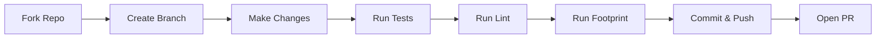
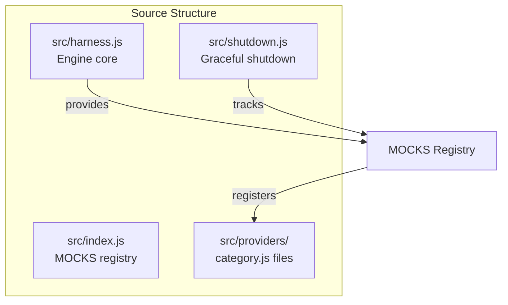
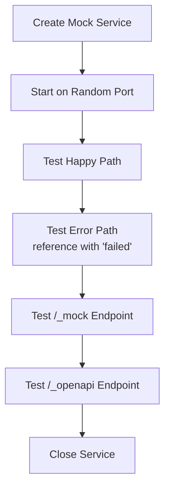

# Contributing to API Mock Services

Thank you for considering contributing! This document outlines the process for contributing to this project.

## Table of Contents

- [Code of Conduct](#code-of-conduct)
- [Getting Started](#getting-started)
- [Development Setup](#development-setup)
- [Making Changes](#making-changes)
- [Testing](#testing)
- [Submitting Changes](#submitting-changes)
- [Adding a New Mock](#adding-a-new-mock)
- [Architecture Overview](#architecture-overview)
- [Style Guide](#style-guide)

## Code of Conduct

This project follows the [Contributor Covenant Code of Conduct](CODE_OF_CONDUCT.md). By participating, you agree to uphold this code.

## Getting Started

1. Fork the repository
2. Clone your fork: `git clone https://github.com/your-username/api-mock-services.git`
3. Install dependencies: `npm ci`
4. Run tests: `npm test`
6. Run lint: `npm run lint`

## Development Setup

```bash
# Install Node.js 20+
nvm use 20

# Install dependencies (none - zero dependencies!)
npm ci

# Run all checks
npm run check

# Start a mock for testing
npm start stripe

# View all available mocks
npm run list
```

## Making Changes



1. Create a new branch: `git checkout -b feature/your-feature-name`
2. Make your changes
3. Run tests: `npm test`
4. Run lint: `npm run lint`
5. Run footprint check: `npm run footprint`
6. Commit with a clear message: `git commit -m "feat: your feature description"`
7. Push to your fork: `git push origin feature/your-feature-name`
8. Open a Pull Request

## Testing

Run the full test suite:

```bash
npm test
```

Run a specific test file:

```bash
node --test test/stripe.test.js
```

Run tests with coverage:

```bash
node --test --experimental-test-coverage test/*.test.js
```

## Submitting Changes

1. Ensure all tests pass (`npm test`)
2. Ensure lint passes (`npm run lint`)
3. Ensure footprint is within budget (`npm run footprint`)
4. Update documentation if needed
5. Add tests for new functionality
6. Update `CHANGELOG.md` with your changes
7. Open a Pull Request with a clear description

## Adding a New Mock

This is the most common contribution. Follow these steps:

### Architecture Overview



### 1. Create the Provider File

Create a new file in `src/providers/` (or add to an existing category file):

```javascript
// src/providers/your-category.js
import { MockService, json, counter } from '../harness.js'

export function createYourProviderMock() {
  const service = new MockService('yourprovider')
  
  service.state.yourData = new Map()
  const nextId = counter('yp')
  
  service.on('GET', '/health', (req, res) => {
    json(res, 200, { status: 'healthy', service: 'yourprovider-mock' })
  })
  
  service.on('POST', '/v1/endpoint', (req, res) => {
    const body = req.json ?? {}
    const id = nextId()
    const isFailed = body.reference?.includes('failed')
    
    const result = { id, status: isFailed ? 'failed' : 'success' }
    json(res, isFailed ? 400 : 200, result)
  })
  
  return service
}
```

### 2. Register in Index

Add the mock to `src/index.js`:

```javascript
// Import
import { createYourProviderMock as yourproviderMock } from './providers/your-category.js'

// Register
export const MOCKS = {
  // ... existing mocks
  yourprovider: {
    create: yourproviderMock,
    port: 4067,  // Next available port
    category: 'yourcategory',
    description: 'The description of your provider',
  },
}

// Export factory
export const createYourProviderMock = withViews(yourproviderMock)
```

### 3. Add Category (if new)

```javascript
export const CATEGORIES = {
  // ... existing categories
  yourcategory: { title: 'Your Category', description: 'Description' },
}
```

### Current Categories (16 total)

```mermaid
graph TD
    PAY[Payments: 8]
    SOC[Social: 9]
    MSG[Messaging: 5]
    EML[Email: 5]
    SHP[Shipping: 5]
    MKT[Marketplaces: 5]
    CRM[CRM: 4]
    ERP[ERP/Inventory: 4]
    TAX[Tax: 3]
    POS[POS: 4]
    ANA[Analytics: 4]
    ID[Identity: 3]
    ACC[Accounting: 4]
    AI[AI: 1]
    STG[Storage: 1]
    DNS[DNS: 1]
```



### 4. Write Tests

Create `test/yourprovider.test.js`:

```javascript
import { test } from 'node:test'
import assert from 'node:assert/strict'
import { MOCKS } from '../src/index.js'

test('yourprovider does something', async () => {
  const service = MOCKS.yourprovider.create()
  await service.listen(0, '127.0.0.1')
  
  // Test happy path
  // Test error path (reference with 'failed')
  // Test /_mock and /_openapi endpoints
  
  await service.close()
})
```

### 5. Update Documentation

- Add to `docs/index.html` mock table
- Add to `examples/docker-compose.yml` with port
- Add to `THIRD-PARTY-NOTICES.md` with trademark info
- Run `npm run routes -- --write` to update ROUTES.md
- Run `npm run openapi -- --write` to generate OpenAPI spec

### 6. Add to Spec Sources (if OpenAPI spec available)

Add to `specs/sources.json`:

```json
{
  "yourprovider": {
    "url": "https://provider.com/openapi.yaml",
    "path": "specs/yourprovider.yaml",
    "mock": "yourprovider",
    "check": true,
    "note": "Provider's OpenAPI spec"
  }
}
```

### 7. Run All Checks

```bash
npm run check
npm run routes -- --write
npm run openapi -- --write
```

## Style Guide

### Code Style

- **ES Modules** (`import`/`export`)
- **2-space indentation**, no tabs
- **No semicolons** (except where required)
- **Single quotes** for strings
- **Trailing commas** in multiline objects/arrays
- **Descriptive variable names** (`userId` not `uid`)
- **JSDoc comments** for exported functions

### File Organization

```
src/
├── harness.js           # Core engine
├── index.js             # Main exports, MOCKS registry
├── shutdown.js          # Graceful shutdown
├── cassette.js          # HTTP record/playback
├── spec.js              # Spec-based mocks
├── providers/           # Provider implementations
│   ├── commerce.js      # Stripe, Resend, Xero, Cloudflare
│   ├── payments.js      # PayPal, Square, Adyen
│   ├── nigeria.js       # Nigeria-specific providers
│   ├── fintech.js       # Flutterwave, Monnify
│   ├── identity.js      # SmileID, IdentityPass
│   ├── messaging.js     # Termii, WhatsApp, FCM
│   ├── ai.js            # OpenAI
│   ├── storage.js       # S3
│   ├── social.js        # Facebook, Instagram, X
│   ├── community.js     # Bluesky, Telegram, Reddit, LinkedIn
│   ├── video.js         # TikTok, YouTube
│   ├── shipping.js      # Shippo, EasyPost, FedEx, UPS, DHL
│   ├── marketplaces.js  # Amazon, Shopify, eBay, Etsy, Walmart
│   ├── email-marketing.js # SendGrid, Mailchimp, Klaviyo, Postmark
│   ├── crm.js           # HubSpot, Salesforce, Pipedrive, Attio
│   ├── accounting-additional.js # QuickBooks, NetSuite, Sage
│   ├── erp-inventory.js # Cin7, DEAR, TradeGecko, Katana
│   ├── tax.js           # Avalara, TaxJar, Vertex
│   ├── pos.js           # Square Terminal, Clover, Toast, Lightspeed
│   └── analytics.js     # Segment, Mixpanel, Amplitude, RudderStack
├── spec.js              # Spec-based mocks
├── ui/                  # Browser UI (panel, checkout)
└── shutdown.js          # Graceful shutdown
```

### Testing Patterns



```javascript
// Always test:
// 1. Happy path
// 2. Error path (reference with 'failed')
// 3. /_mock endpoint
// 4. /_openapi endpoint

test('provider does something', async () => {
  const service = MOCKS.provider.create()
  await service.listen(0, '127.0.0.1')
  
  // Happy path
  const success = await fetch(`${service.url}/endpoint`, { ... })
  assert.equal(success.status, 200)
  
  // Error path
  const failed = await fetch(`${service.url}/endpoint`, {
    body: JSON.stringify({ reference: 'failed_test' })
  })
  assert.equal(failed.status, 400)
  
  // Identity
  const identity = await fetch(`${service.url}/_mock`)
  assert.equal(identity.json.kind, 'mock')
  
  // OpenAPI
  const spec = await fetch(`${service.url}/_openapi`)
  assert.ok(spec.json.openapi)
  
  await service.close()
})
```

### Commit Message Format

```
<type>(<scope>): <description>

[optional body]

[optional footer]
```

Types: `feat`, `fix`, `docs`, `style`, `refactor`, `test`, `chore`, `perf`

Example:
```
feat(payments): add Square Terminal mock with checkout support

- Add createSquareTerminalMock with checkout/payment flow
- Add tests for happy path, error path, cancellation
- Update docker-compose.yml, docs/index.html, THIRD-PARTY-NOTICES.md
- Regenerate OpenAPI specs and ROUTES.md
```

## Questions?

Open an issue or start a discussion. We're happy to help!